# 🚀 Sistema Inteligente de Empregabilidade & Automação de Carreira

Desenvolvi este ecossistema multiagente em **Python** e **FastAPI** para automatizar a gestão do meu perfil profissional, a ingestão de conhecimento por certificados, a busca de vagas compatíveis e a adaptação de currículos orientada a metas.

---

## 🏛️ Visão Geral do Projeto

O objetivo do meu projeto é construir uma plataforma modular e orientada a serviços (microsserviços/agentes) que me ajude a gerenciar minha carreira de forma automatizada e inteligente. Estruturei o ecossistema em módulos especializados:

1. **Agente de Ingestão de Conhecimento (`AgenteIngestaoConhecimento`)**: Responsável por processar meus uploads de certificados/documentos e atualizar dinamicamente o meu perfil técnico.
2. **Agente Analista de Perfil (`AgenteAnalistaPerfil`)**: Mapeia minhas competências e avalia o grau de compatibilidade com cargos e requisitos do mercado.
3. **Agente Caçador de Vagas (`AgenteCacadorVagas`)**: Realiza varreduras e ranqueamento de vagas alinhadas ao meu perfil técnico e desejos de carreira.
4. **Agente Alfaiate (`AgenteAlfaiateCurriculo`)**: Adapta e reescreve meus currículos especificamente para as descrições das vagas desejadas.

---

## 📊 Diagrama de Arquitetura & Visão Global do Ecossistema (UML)

Abaixo apresento a representação UML completa da arquitetura do projeto, englobando tanto os modelos de dados centrais quanto os agentes inteligentes implementados no back-end:

```mermaid
classDiagram
    class PerfilProfissional {
        +str nome_completo
        +str cargo_desejado
        +List[str] competencias_tecnicas
        +List[str] experiencias
        +List[CertificadoOuCurso] cursos_e_certificados
    }

    class CertificadoOuCurso {
        +str titulo
        +str instituicao
        +List[str] tecnologias_adquiridas
        +Optional[str] data_conclusao
    }

    class VagaEmprego {
        +str titulo
        +str empresa
        +List[str] requisitos
        +str descricao
    }

    class AnaliseCompatibilidade {
        +int percentual_compatibilidade
        +List[str] competencias_em_comum
        +List[str] competencias_faltantes
        +List[str] recomendacoes_estudo
        +str parecer_geral
    }

    class CurriculoAdaptado {
        +PerfilProfissional perfil_base
        +VagaEmprego vaga_alvo
        +str resumo_profissional_otimizado
        +List[str] competencias_destacadas
        +str conteudo_otimizado
    }

    class GerenciadorPerfil {
        +obter_perfil() PerfilProfissional
        +salvar_perfil(PerfilProfissional)
        +adicionar_certificado(CertificadoOuCurso)
    }

    class AgenteIngestaoConhecimento {
        +processar_documento(arquivo)
        +atualizar_perfil(PerfilProfissional)
        +ingerir_certificado(arquivo)
    }

    class AgenteAnalistaPerfil {
        +analisar_texto_para_perfil(texto_bruto) PerfilProfissional
        +extrair_certificado_de_texto(texto_bruto) CertificadoOuCurso
        +analisar_compatibilidade(PerfilProfissional, VagaEmprego) AnaliseCompatibilidade
    }

    class AgenteCacadorVagas {
        +buscar_vagas(criterios)
        +List[VagaEmprego] vagas
    }

    class AgenteAlfaiateCurriculo {
        +adaptar_curriculo(PerfilProfissional, VagaEmprego) CurriculoAdaptado
    }

    PerfilProfissional "1" --> "*" CertificadoOuCurso : gerencia
    GerenciadorPerfil --> PerfilProfissional : persiste
    AgenteIngestaoConhecimento --> GerenciadorPerfil : utiliza
    AgenteIngestaoConhecimento --> PerfilProfissional : atualiza
    AgenteAnalistaPerfil --> PerfilProfissional : analisa
    AgenteAnalistaPerfil --> VagaEmprego : avalia
    AgenteAnalistaPerfil --> AnaliseCompatibilidade : gera
    AgenteCacadorVagas --> VagaEmprego : descobre
    AgenteAlfaiateCurriculo --> CurriculoAdaptado : gera

```



---

## 🛠️ Stack Tecnológica

- **Linguagem:** Python 3.10+
- **Framework Web:** FastAPI + Uvicorn
- **Validação de Dados:** Pydantic v2
- **Banco de Dados:** SQLite (`sqlite3` nativo do Python)
- **Inteligência Artificial:** Google GenAI SDK (`google-genai`)
- **Processamento de PDF:** `pypdf` & `python-multipart`
- **Controle de Versão:** Git & GitHub

---

## 📂 Estrutura de Pastas do Projeto

```text
sistema_empregabilidade/
├── dados/
│   └── empregabilidade.db            # Banco de dados relacional SQLite (perfil, certificados e vagas)
├── servicos/
│   ├── agente_alfaiate.py            # Agente Alfaiate (reescrita e adaptação de currículos ATS)
│   ├── agente_analista.py            # Agente Analista (extração IA e cálculo de compatibilidade)
│   ├── agente_cacador.py             # Agente Caçador de Vagas (busca e ranqueamento no SQLite)
│   ├── banco_dados.py                # GerenciadorBancoDados (conexão e criação de tabelas SQLite)
│   ├── gerenciador_perfil.py         # Serviço de persistência SQL e fusão incremental de competências
│   └── processador_arquivo.py        # ProcessadorDocumento e AgenteIngestaoConhecimento
├── uploads/                          # Certificados PDF de exemplo para testes
├── main.py                           # Servidor FastAPI e rotas da API
├── modelos.py                        # Schemas e contratos Pydantic
├── parser.py                         # Módulo de compatibilidade do ProcessadorDocumento
├── requirements.txt                  # Dependências do projeto
└── README.md                         # Documentação geral
```

---

## ⚙️ Evolução das Fases Implementadas

### Fase 1: Fundação & Modelagem de Dados
- **Modelagem de Dados Robusta (`modelos.py`):** Classes em **Pydantic** (`BaseModel`, `Field`) e tipagem estática (`Optional`, `List`) em português brasileiro para validar o perfil profissional (`PerfilProfissional`), certificados (`CertificadoOuCurso`), vagas (`VagaEmprego`), relatórios de aderência (`AnaliseCompatibilidade`) e currículos otimizados (`CurriculoAdaptado`).
- **API Base (`main.py`):** Configuração do servidor **FastAPI** com documentação Swagger automática (`/docs`) e middleware CORS.

### Fase 2: Ingestão Real e Parser de Documentos
- **Processador de Documentos (`servicos/processador_arquivo.py` e `parser.py`):** Classe utilitária `ProcessadorDocumento` utilizando **`pypdf`** para leitura ponta a ponta de ficheiros PDF reais.
- **Ciclo de Vida Seguro do Arquivo:** Salvamento temporário em `temp_uploads`, sanitização do nome do arquivo e remoção automática no bloco `finally`.

### Fase 3: Extração Estruturada com IA (Gemini) & Persistência SQLite
- **Integração com o Google GenAI SDK (`servicos/agente_analista.py`):** Uso de *Structured Outputs* (`response_schema`) para extrair tanto currículos completos (`PerfilProfissional`) quanto certificados individuais (`CertificadoOuCurso`), contando também com modo de contingência (fallback local) para alta disponibilidade.
- **Banco de Dados SQLite (`servicos/banco_dados.py`, `servicos/gerenciador_perfil.py`) e `AgenteIngestaoConhecimento`:** Persistência relacional em SQLite (`dados/empregabilidade.db` com tabelas `perfil_profissional`, `certificados` e `vagas_emprego`) e fusão inteligente de competências — ao enviar um novo certificado PDF em `/perfil/upload-certificado`, o sistema extrai as tecnologias aprendidas e atualiza o perfil no banco sem duplicar itens.

### Fase 4: Agentes de Compatibilidade, Caça de Vagas e Alfaiate de Currículos
- **Agente Caçador de Vagas (`servicos/agente_cacador.py`):** Filtra vagas por palavras-chave e ordena automaticamente as oportunidades de acordo com a pontuação de compatibilidade com as competências atuais do perfil.
- **Análise de Compatibilidade (`AgenteAnalista.analisar_compatibilidade`):** Compara o `PerfilProfissional` com qualquer `VagaEmprego`, calculando o percentual de aderência (0 a 100%), competências em comum, competências faltantes (gaps) e recomendações práticas de estudo.
- **Agente Alfaiate (`servicos/agente_alfaiate.py`):** Adapta o currículo do usuário para uma vaga específica (`/curriculo/adaptar`), destacando as competências mais relevantes e gerando o currículo completo em Markdown pronto para uso.

---

## 🚀 Como Executar o Projeto

1. **Ative o ambiente virtual e instale as dependências:**
   ```bash
   .\.venv\Scripts\activate
   pip install -r requirements.txt
   ```

2. **Configure a variável de ambiente no arquivo `.env`:**
   ```env
   GEMINI_API_KEY=sua_chave_aqui
   ```

3. **Inicie o servidor FastAPI:**
   ```bash
   uvicorn main:app --reload
   ```

4. **Acesse a documentação interativa (Swagger UI):**
   - Abra no navegador: `http://127.0.0.1:8000/docs`

---

## 🗺️ Roadmap / Evolução da Implementação

- [x] **Fase 1:** Estruturação da API, rotas FastAPI, modelos Pydantic e simulação de dados/upload.
- [x] **Fase 2:** Implementação real do parser de documentos (leitura de PDFs/Certificados).
- [x] **Fase 3:** Integração com LLMs (Google Gemini) para extração semântica de conhecimentos e persistência de perfil.
- [x] **Fase 4:** Desenvolvimento dos Agentes de Busca de Vagas, Análise de Compatibilidade e Adaptação de Currículos.
- [ ] **Fase 5:** Construção do Front-end em Next.js / TypeScript com painel interativo.
