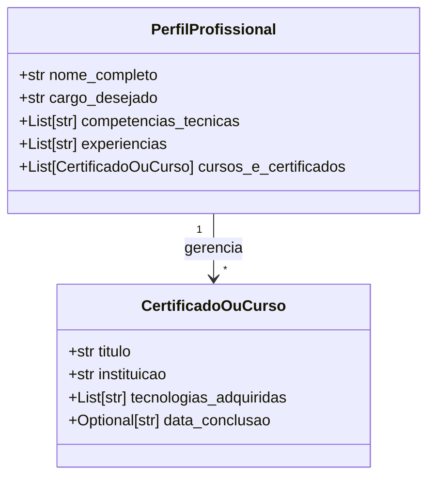

# 🚀 Sistema Inteligente de Empregabilidade & Automação de Carreira

Desenvolvi este ecossistema multiagente em **Python** e **FastAPI** para automatizar a gestão do meu perfil profissional, a ingestão de conhecimento por certificados, a busca de vagas compatíveis e a adaptação de currículos orientada a metas.

---

## 🏛️ Visão Geral do Projeto
O objetivo do meu projeto é construir uma plataforma modular e orientada a serviços (microsserviços/agentes) que me ajude a gerenciar minha carreira de forma automatizada e inteligente. Estruturei o ecossistema em módulos especializados:

1. **Agente de Ingestão de Conhecimento (`AgenteIngestaoConhecimento`)**: Responsável por processar meus uploads de certificados/documentos e atualizar dinamicamente o meu perfil técnico.
2. **Agente Analista de Perfil (`AgenteAnalistaPerfil`)**: Mapeia minhas competências e alinha cargos compatíveis (planejado).
3. **Agente Caçador de Vagas (`AgenteCacadorVagas`)**: Realiza varreduras por vagas alinhadas ao meu perfil no mercado (planejado).
4. **Agente Alfaiate (`AgenteAlfaiateCurriculo`)**: Adapta meus currículos especificamente para as descrições das vagas desejadas (planejado).

---

## 📊 Diagrama de Arquitetura & Classes (UML)

Abaixo apresento a representação UML da estrutura de dados atual (modelos Pydantic) que garante a tipagem e a validação da minha API:

---
   
## 🛠️ Stack Tecnológica
- **Linguagem:** Python 3.10+
- **Framework Web:** FastAPI
- **Validação de Dados:** Pydantic
- **Controle de Versão:** Git & GitHub

---

## ⚙️ O que implementei nesta Fase (Fase 1: Fundação & Mockups)
Nesta primeira etapa, foquei na construção da base estrutural e arquitetural do back-end para garantir robustez e tipagem estática antes da introdução dos modelos de Inteligência Artificial:

- **Modelagem de Dados Robusta (`modelos.py`):** Criei classes utilizando **Pydantic** (`BaseModel`, `Field`) e tipagem estática (`Optional`, `List`) totalmente em português brasileiro para validar meu perfil profissional (`PerfilProfissional`), minhas experiências e meus cursos/certificados (`CertificadoOuCurso`).
- **API de Ingestão (`main.py`):** Configurei o servidor **FastAPI** contendo rotas assíncronas para upload de arquivos e persistência temporária (`/perfil/upload-certificado` e `/perfil`).
- **Testes e Mockups:** Implementei dados simulados do meu perfil de usuário para validar o fluxo de requisições, o armazenamento em disco e a manipulação de listas e objetos antes de plugar serviços de IA externos.

---

## 🗺️ Roadmap / Evolução da Implementação
- [x] **Fase 1:** Estruturação da API, rotas FastAPI, modelos Pydantic e simulação de dados/upload.
- [ ] **Fase 2:** Implementação real do parser de documentos (leitura de PDFs/Certificados).
- [ ] **Fase 3:** Integração com LLMs (APIs de Inteligência Artificial) para extração semântica de conhecimentos.
- [ ] **Fase 4:** Desenvolvimento dos Agentes de Busca de Vagas e Adaptação de Currículos.
- [ ] **Fase 5:** Construção do Front-end em Next.js / TypeScript com painel interativo.
    
