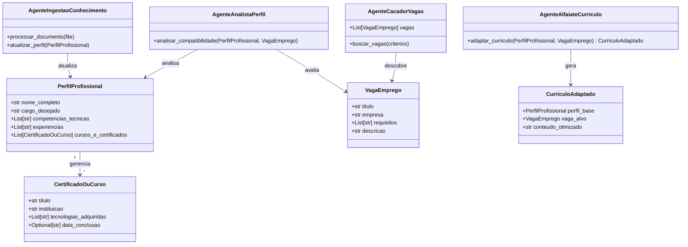

# 🚀 Sistema Inteligente de Empregabilidade & Automação de Carreira

Desenvolvi este ecossistema multiagente em **Python** e **FastAPI** para automatizar a gestão do meu perfil profissional, a ingestão de conhecimento por certificados, a busca de vagas compatíveis e a adaptação de currículos orientada a metas.

---

## 🏛️ Visão Geral do Projeto

O objetivo do meu projeto é construir uma plataforma modular e orientada a serviços (microsserviços/agentes) que me ajude a gerenciar minha carreira de forma automatizada e inteligente. Estruturei o ecossistema em módulos especializados:

1. **Agente de Ingestão de Conhecimento (`AgenteIngestaoConhecimento`)**: Responsável por processar meus uploads de certificados/documentos e atualizar dinamicamente o meu perfil técnico.
2. **Agente Analista de Perfil (`AgenteAnalistaPerfil`)**: Mapeia minhas competências e avalia o grau de compatibilidade com cargos e requisitos do mercado.
3. **Agente Caçador de Vagas (`AgenteCacadorVagas`)**: Realiza varreduras automáticas por vagas alinhadas ao meu perfil técnico e desejos de carreira.
4. **Agente Alfaiate (`AgenteAlfaiateCurriculo`)**: Adapta e reescreve meus currículos especificamente para as descrições das vagas desejadas.

---

## 📊 Diagrama de Arquitetura & Visão Global do Ecossistema (UML)

Abaixo apresento a representação UML completa da arquitetura do projeto, englobando tanto os modelos de dados centrais quanto os agentes inteligentes planeidados para as próximas fases:

---

## 🛠️ Stack Tecnológica

- **Linguagem:** Python 3.10+
- **Framework Web:** FastAPI
- **Validação de Dados:** Pydantic
- **Controle de Versão:** Git & GitHub

---

## ⚙️ O que implementei na Fase 1: Fundação & Mockups

Nesta primeira etapa, foquei na construção da base estrutural e arquitetural do back-end para garantir robustez e tipagem estática antes da introdução dos modelos de Inteligência Artificial:

- **Modelagem de Dados Robusta (`modelos.py`):** Criei classes utilizando **Pydantic** (`BaseModel`, `Field`) e tipagem estática (`Optional`, `List`) totalmente em português brasileiro para validar meu perfil profissional (`PerfilProfissional`), minhas experiências e meus cursos/certificados (`CertificadoOuCurso`).
- **API de Ingestão (`main.py`):** Configurei o servidor **FastAPI** contendo rotas assíncronas para upload de arquivos e persistência temporária (`/perfil/upload-certificado` e `/perfil`).
- **Testes e Mockups:** Implementei dados simulados do meu perfil de usuário para validar o fluxo de requisições, o armazenamento em disco e a manipulação de listas e objetos antes de plugar serviços de IA externos.

## ⚙️ O que implementei na Fase 2: Ingestão Real e Parser de Documentos

Nesta segunda etapa, evoluí o back-end para processar ficheiros e dados reais diretamente do disco, eliminando os mockups estáticos e preparando o terreno para a extração automatizada:

- **Parser de Documentos (`parser.py`):** Implementei a classe utilitária `DocumentParser` utilizando a biblioteca **`pypdf`** para realizar a leitura ponta a ponta de ficheiros PDF reais (como currículos e certificados), extraindo o texto bruto de forma estruturada.
- **Upload Assíncrono e Multipart:** Configurei a rota assíncrona `/perfil/upload-certificado` no **FastAPI** utilizando a dependência **`python-multipart`** para receber ficheiros em formato binário via requisições HTTP POST.
- **Ciclo de Vida do Arquivo:** Estruturei o fluxo de salvamento temporário no disco (`temp_uploads`), leitura bem-sucedida do conteúdo textual e remoção automática do ficheiro após o processamento, garantindo a limpeza e segurança do ambiente de execução.

## 🚀 Fase 3: Extração de Dados Estruturados com Inteligência Artificial (Gemini)

## 3.1

Nesta fase, implementámos o pipeline completo de processamento e análise semântica de currículos e documentos em PDF utilizando o FastAPI em conjunto com a nova SDK oficial do Google (`google-genai`) e o Pydantic (`PerfilProfissional`).

### 🛠️ O que foi feito:

- **Integração com o Google GenAI SDK:** Configuração do cliente oficial do Gemini (`gemini-3.8-flash`) para processamento inteligente de linguagem natural.
- **Validação e Schema com Pydantic:** Estruturação automatizada dos dados extraídos (nome completo, cargo desejado, competências técnicas, experiências e histórico de cursos/certificados) garantindo tipagem rigorosa.
- **Endpoint Assíncrono (`/perfil/analisar-documento`):** Criação da rota no FastAPI para upload de ficheiros PDF, extração de texto bruto e mapeamento estruturado via IA.
- **Tratamento de Exceções e Resiliência:** Implementação de capturas de traceback detalhadas e tratamento defensivo de respostas para garantir alta estabilidade no servidor local.

---

## 🗺️ Roadmap / Evolução da Implementação

- [x] **Fase 1:** Estruturação da API, rotas FastAPI, modelos Pydantic e simulação de dados/upload.
- [x] **Fase 2:** Implementação real do parser de documentos (leitura de PDFs/Certificados).
- [ ] **Fase 3:** Integração com LLMs (APIs de Inteligência Artificial) para extração semântica de conhecimentos.
- [ ] **Fase 4:** Desenvolvimento dos Agentes de Busca de Vagas e Adaptação de Currículos.
- [ ] **Fase 5:** Construção do Front-end em Next.js / TypeScript com painel interativo.
